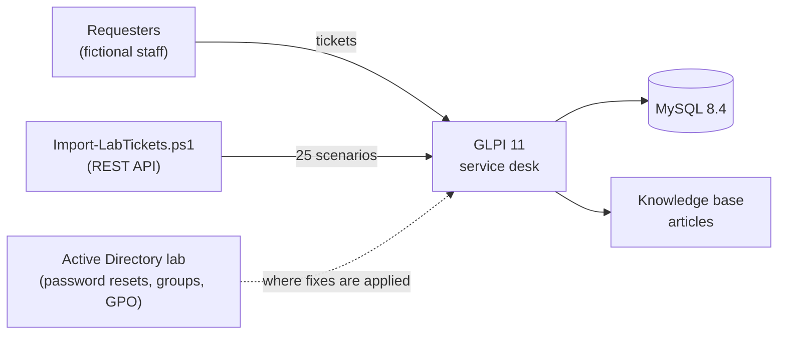

# Help Desk Ticketing and Knowledge Base Lab

A working IT service desk built on [GLPI](https://glpi-project.org/), an open-source ITSM platform used by real help desks. It is loaded with 25 realistic tickets from a fictional 50-person office, and I work them the way a Tier 1 analyst would: triage, prioritize against SLAs, troubleshoot, document, escalate when needed, and turn repeat fixes into knowledge base articles.

The goal is to show the day-to-day of a help desk role, not just the tools: clear ticket notes, sensible priorities, and fixes written so the next person can follow them.

## Architecture



| Component | Details |
|---|---|
| GLPI | `glpi/glpi:11.0.11` (official image), served on `127.0.0.1:8090` only |
| Database | `mysql:8.4`, random root password, app password in `.env` (not committed) |
| Ticket bank | [`tickets/tickets.json`](tickets/tickets.json): 25 incidents and requests across 9 categories |
| Loader | [`scripts/Import-LabTickets.ps1`](scripts/Import-LabTickets.ps1): creates categories, requester accounts and tickets through the GLPI REST API; safe to re-run (skips existing tickets); supports `-WhatIf` |
| Fixes applied in | [active-directory-lab](https://github.com/EbubeNnaemeka/active-directory-lab) and [windows-desktop-support-lab](https://github.com/EbubeNnaemeka/windows-desktop-support-lab) |

## Setup

Requires Docker and PowerShell 7 (`pwsh`). Runs on Apple Silicon and x86.

```bash
cp .env.example .env              # then set a strong GLPI_DB_PASSWORD
docker compose up -d              # first start installs GLPI (about 1-2 minutes)
./scripts/enable-api.sh           # turns on the REST API, prints an app token
pwsh ./scripts/Import-LabTickets.ps1 -AppToken <token> -Credential (Get-Credential glpi)
```

Open http://127.0.0.1:8090. GLPI ships with four default accounts (`glpi`, `tech`, `normal`, `post-only`, each with the same password as its name). **Change all four passwords on first login** (GLPI shows a warning until you do), then re-run the import with the new `glpi` password.

## How I work the tickets

1. **Triage.** Read the ticket, confirm it's an incident (something broke) or a request (something is needed), set the category, and check the priority GLPI calculated from urgency x impact against the [SLA policy](docs/sla-policy.md).
2. **Acknowledge** within the SLA's response target with a short follow-up to the requester.
3. **Troubleshoot** in the lab environment, logging each step as a ticket task with time spent.
4. **Resolve or escalate.** Resolve with a solution note the requester can understand, or escalate to Tier 2 with what was already checked, using the [escalation template](docs/escalation-template.md).
5. **Document.** If the fix is likely to come back, write a knowledge base article with the [KB template](kb/KB-TEMPLATE.md) and link it to the ticket.

The scenarios cover the most common Tier 1 work in Toronto service desk postings: account lockouts and password resets, onboarding and offboarding, mapped drives and permissions, printers, Outlook and Teams, slow PCs and full disks, network and VPN issues, phishing reports, MFA and BitLocker recovery, and hardware requests. [`docs/ticket-guide.md`](docs/ticket-guide.md) lists what each ticket is really testing.

## Results

Tracked in [`ticket-log.md`](ticket-log.md). Numbers come from GLPI's statistics view (Assistance > Statistics).

| Metric | Result |
|---|---|
| Tickets resolved | _fill in_ / 25 |
| Met response SLA | _fill in_ % |
| Met resolution SLA | _fill in_ % |
| Escalated to Tier 2 | _fill in_ |
| Knowledge base articles written | _fill in_ |

## Resume bullet (use once you have completed and verified the lab)

> Ran a GLPI service desk with 25 realistic incidents and requests (lockouts, onboarding, printers, VPN, phishing), meeting [N]% of SLA targets and writing [N] knowledge base articles for recurring issues.

## Repo contents

```
├── README.md
├── docker-compose.yml          GLPI + MySQL, localhost only
├── .env.example                copy to .env (gitignored)
├── tickets/tickets.json        25-ticket scenario bank
├── scripts/
│   ├── enable-api.sh           enables the REST API and creates an app token
│   └── Import-LabTickets.ps1   loads the tickets through the API
├── docs/
│   ├── sla-policy.md           priority matrix and response/resolution targets
│   ├── ticket-guide.md         what each ticket tests and where to look
│   └── escalation-template.md
├── kb/KB-TEMPLATE.md           knowledge base article template
└── ticket-log.md               my results, filled in as I work the queue
```
